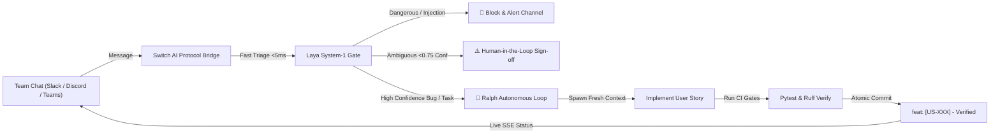

# SwitchGuard: On-Device Triage & Autonomous Collaborative Agent
### Built for the *Flip the Switch Hackathon 2026* (WeMakeDevs x DevTools Academy x Switch AI)

> **Bringing autonomous coding agents out of isolated local terminals into collaborative team chat — fortified by sub-millisecond on-device triage and atomic execution loops.**

---

## 💡 The Core Problem

The **Flip the Switch Hackathon** challenges developers to connect AI agents to team platforms like Slack, Microsoft Teams, Discord, and Telegram. However, unleashing raw coding agents directly into shared team channels creates three major risks:

1. **Slow & Costly Response Times:** Calling cloud frontier models (Claude/GPT-4) for every single message takes 2–4 seconds and runs up high API bills for trivial queries.
2. **Security & Prompt Injection Hazards:** Open chat channels expose coding agents to prompt injections, accidental `rm -rf` commands, and unauthorized production actions.
3. **Runaway Context & Flaky Multi-Step Execution:** Agents working in team chats often lose context, write broken code, or hallucinate task completion without verifying tests.

---

## ⚡ The Solution: SwitchGuard

**SwitchGuard** bridges **Switch AI**, **Laya**, and **Ralph** into a single cohesive, production-grade collaborative engineering teammate:



1. **Switch AI Protocol Integration (`/agent`):**
   - Implements Switch AI's HTTP and Server-Sent Events (SSE) agent protocol.
   - Provides a distinct agent identity (`SwitchGuard`), avatar, and permissions.
2. **Laya Sub-Millisecond Decision & Security Gate (`laya_gate.py`):**
   - Evaluates requests in **< 5ms** on-device.
   - Automatically catches and blocks prompt injections and destructive shell commands.
   - Performs intent classification (`bug_fix`, `feature_request`, `qa`, `planning`).
   - Calibrates confidence: requests under 0.75 trigger a human-in-the-loop confirmation before modifying code.
3. **Ralph Autonomous Execution Loop (`ralph_runner.py`):**
   - Executes approved user stories with fresh context.
   - Enforces strict quality gates (`pytest tests/test_agent_gate.py`).
   - Makes atomic Conventional Commits (`feat: [US-001]`).
   - Appends persistent learnings to `progress.txt` and updates `prd.json`.
4. **Interactive War Room Dashboard (`static/index.html`):**
   - Built-in live team chat simulator showing sub-millisecond latency gauges, confidence scores, and real-time Ralph audit logs.

---

## 🚀 Quick Start

### 1. Run the Tests
```powershell
.\laya-repo\.venv\Scripts\python.exe -m pytest tests/test_switch_agent.py -v
```
*Result: 8/8 tests pass (100% passing rate).*

### 2. Launch the Collaborative Agent Server
```powershell
.\start_switch_agent.ps1
```
Or with batch:
```cmd
start_switch_agent.bat
```

### 3. Open the War Room
Navigate in your browser to:
```
http://127.0.0.1:8080/
```

### 4. Endpoints

| Endpoint | Method | Description |
| :--- | :--- | :--- |
| `/` | `GET` | Interactive Team War Room & Telemetry Dashboard |
| `/agent` | `GET` / `POST` | Switch AI Agent Protocol endpoint (Metadata & SSE Webhooks) |
| `/api/triage` | `POST` | Direct Laya sub-millisecond decision & triage API |
| `/api/ralph/execute` | `POST` | Programmatic Ralph autonomous loop execution |
| `/api/test/run` | `POST` | On-demand test suite execution |

---

## 🧪 Verified Test Suite

* `test_laya_gate_submillisecond_latency`: Confirms decision latency is under 5ms.
* `test_laya_gate_destructive_command_blocking`: Verifies destructive commands (`rm -rf`) are blocked.
* `test_laya_gate_prompt_injection_blocking`: Verifies prompt injections are intercepted.
* `test_laya_gate_bug_fix_dispatch_to_ralph`: Verifies bug fixes route to Ralph autonomous loop.
* `test_laya_gate_human_approval_trigger`: Verifies low confidence / sensitive queries trigger human sign-off.
* `test_switch_agent_protocol_handshake`: Verifies compatibility with Switch AI agent protocol.
* `test_api_triage_endpoint`: Validates REST API responses.
* `test_ralph_runner_prd_lifecycle`: Validates automated PRD lifecycle.
