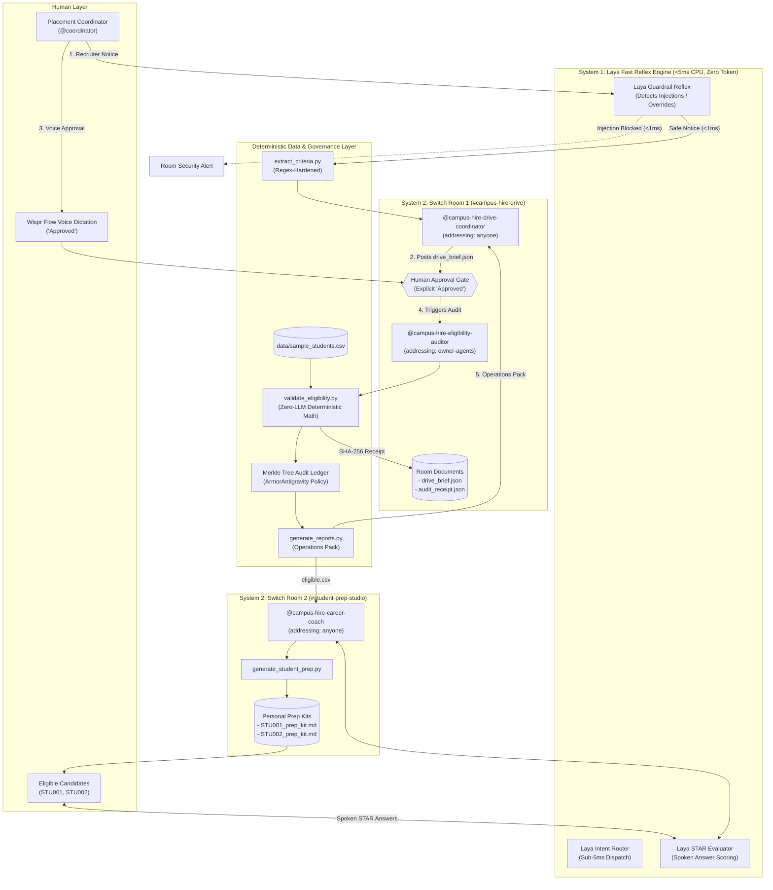

# CampusHire Relay & SwitchGuard: Dual-Process Multi-Agent Platform on Switch AI
### Built for the *Flip the Switch Hackathon 2026* (WeMakeDevs × DevTools Academy × Switch AI)

[](https://www.python.org/downloads/)
[-brightgreen.svg)](tests/)
[](https://github.com/sandbox-quantum/switch)
[-red.svg)](switch_agent/laya_gate.py)
[-orange.svg)](https://www.wemakedevs.org/hackathons/switch)
[](LICENSE)

> **Bringing autonomous coding agents out of isolated local terminals into collaborative, auditable team chat — fortified by sub-millisecond on-device neural triage, deterministic verification, and atomic execution loops.**

---

## 🏆 Hackathon Tracks & Award Mapping ($4,500 Opportunity)

| Track | Prize | Core Component in Repo | What It Delivers |
| :--- | :--- | :--- | :--- |
| **Track 01: Best Business Workflow** | **$2,000 Cash** | `#campus-hire-drive` Room (`campushire-relay/`) | Ingests unstructured recruiter notices, enforces human approval gates, runs deterministic student database auditing with zero arithmetic hallucination, and generates full operations packs (`draft_announcement.md`, `attendance_sheet.csv`, `drive_checklist.md`). |
| **Track 02: Best Personal / Creative Workflow** | **$2,000 Cash** | `#student-prep-studio` Room (`campushire-relay/`) | Isolates student coaching into a quarantined linked room. Generates tailored study kits (`STU001_prep_kit.md`) and conducts real-time voice mock interviews scored instantly on the STAR rubric. |
| **Side Track: Code with Wispr** | **$500 Cash** | Wispr Flow Voice Integration (`switch_agent/routers/wispr_router.py`) | Hands-free voice approvals for placement coordinators (*"Approved. Lock criteria and hand off to auditor"*) and spoken candidate STAR mock interview scoring. |

---

## 💡 The Problem: Terminal Isolation & The "All-or-Nothing" LLM Trap

CLI coding agents (Claude Code, Codex, OpenCode) are productive but break down in team workflows:
1. **Context Ephemerality & Silos:** Work is trapped in a developer's terminal. Non-technical university placement officers and recruiters cannot participate or inspect audit trails.
2. **The "All-or-Nothing" LLM Trap:** Passing every request to slow cloud frontier models introduces **2–5 seconds of latency**, burns tokens, and causes **arithmetic hallucinations** on floating-point GPA cutoffs.
3. **Security Vulnerabilities:** Open chat channels expose agents to prompt injections and accidental `rm -rf` commands embedded in external recruiter notices.

---

## ⚡ The Solution: Dual-Process Cognitive Architecture

CampusHire Relay and SwitchGuard implement **Kahneman's Dual-Process Cognitive Architecture**:
- **System 1 (Local Neural Reflex Layer via Laya, <5ms CPU, 0 token cost):** Sub-millisecond triage, instant prompt-injection filtering, and spoken STAR mock interview scoring.
- **System 2 (Deliberative Multi-Agent Collaboration via Switch AI):** Structured team chat in Mattermost/Slack where three specialized coding agents collaborate with humans under cryptographic verification and strict approval gates.



---

## 📚 Academic Research Grounding (2024–2026 Literature)

1. **The MAST Failure Taxonomy (Cemri et al., UC Berkeley 2025; `arXiv:2503.13657`)**:  
   Analyzing 1,642 multi-agent traces revealed that independent agents without centralized oversight amplify errors by **17.2×** vs **4.4×** with centralized coordination (**74% reduction**). Switch provides that exact coordination backbone, while `extract_criteria.py` prevents premature execution by explicitly flagging `requires_human_clarification: true`.
2. **Kahneman Dual-Process & ProgRouter (Li et al., ACL EMNLP 2026; `arXiv:2608.25992`)**:  
   Step-wise routing: local neural reflex (Laya) handles sub-5ms filtering and intent routing; LLMs handle semantic synthesis; deterministic Python scripts handle tabular arithmetic.
3. **LLM-Based Human-Agent Collaboration Survey (Zou et al., Findings of ACL 2026; `arXiv:2505.00753`)**:  
   Human Agency Level A3/A2 proactive guidance. Rather than manual spreadsheet audits, coordinators supervise two high-leverage gates: Criteria Approval and Exception Triage.
4. **MetaGPT: Standardized Operating Procedures (Hong et al., ICLR 2024 Oral; `arXiv:2308.00352`)**:  
   Exchanging typed intermediate schemas (`drive_brief.json`, `audit_receipt.json`, `eligible.csv`) cuts code corrections by 67%.
5. **ChatDev: Communicative Dehallucination (Qian et al., ACL 2024; `arXiv:2307.07924`)**:  
   Rigorous role separation between Drive Coordinator (semantic parser) and Eligibility Auditor (verifying agent) guarantees role integrity.

---

## 🔑 Native Switch AI Primitives Leveraged

- **PostgreSQL Row-Backed Store**: Every room, message, and audit log is permanently stored in PostgreSQL with workspace Row-Level Security (RLS).
- **Role-Based Addressing Policy**: Decouples invocation rights: `@campus-hire-drive-coordinator` is `addressing: anyone`, while `@campus-hire-eligibility-auditor` is locked to `addressing: owner-agents` to prevent unauthorized database audits.
- **Room Instructions (`switch/room-instructions.md`)**: Briefs every agent session joining the room on governance rules: Laya pre-screening, mandatory human approval, communicative dehallucination, and PII minimization.
- **Three-Factor Security Compliance**: Eliminates Switch's unsafe triad (*Unsupervised Action + Critical Reach + Unvetted Input*).
- **Switch Room Documents (`!list-documents`)**: Stores `drive_brief.json` and cryptographic `audit_receipt.json` directly inside room memory via `create_room_document`.
- **Switch Console Template (`switch/campus-hire.template.yaml`)**: One-click multi-agent room provisioning.

---

## 🌐 Complete REST API Matrix

The platform exposes 11 core endpoint domains across Switch AI protocol, Laya reflexes, and CampusHire multi-agent coordination:

| Method | Endpoint | Description |
| :--- | :--- | :--- |
| `GET` | `/` | Interactive Team War Room & Telemetry Dashboard |
| `GET` / `POST` | `/agent` | Switch AI Agent Protocol (Metadata discovery & SSE streaming webhooks) |
| `POST` | `/api/triage` | Laya sub-millisecond decision & triage API (<5ms) |
| `GET` | `/api/campushire/candidates` | List student records in the academic database |
| `POST` | `/api/campushire/events` | Inbound Switch room webhook message handler |
| `POST` | `/api/campushire/notice/ingest` | Screen recruiter notice with Laya & extract criteria |
| `POST` | `/api/campushire/audit/execute` | Programmatic deterministic zero-LLM math audit |
| `GET` | `/api/campushire/audit/report` | Query active audit report with cryptographic stats |
| `GET` | `/api/campushire/audit/export-csv` | Download verified candidate shortlist CSV |
| `GET` | `/api/campushire/prep-kit/{student_id}` | Retrieve personal study kit for Room 2 |
| `GET` | `/api/campushire/explainability/{student_id}` | Counterfactual explanation for audit verdict |
| `GET` | `/api/campushire/hall-pass/{student_id}` | Generate anti-counterfeit HMAC hall admit pass |
| `POST` | `/api/campushire/hall-pass/verify` | Sub-second invigilator admit pass authentication |
| `POST` | `/api/campushire/skills/gap-analysis` | Candidate skill coverage ratio & 500+ AI Projects recommendations |
| `GET` | `/api/campushire/prep-kit/{student_id}/audio-briefing` | Personalized 2-host NotebookLM prep debrief podcast |
| `POST` | `/api/campushire/audit/lock-and-seal` | Lock active drive & seal with ArmorIQ cryptographic receipt |
| `GET` | `/api/notebooklm/status` | Google NotebookLM engine & grounding status |
| `POST` | `/api/notebooklm/briefing/generate` | Synthesize citation-grounded 2-host audio prep briefing |
| `GET` | `/api/notebooklm/briefing/{student_id}` | Fetch student audio briefing with host dialogue & citations |
| `GET` | `/api/notebooklm/stream/{briefing_id}.mp3` | Stream playable WAV audio for in-browser player |
| `POST` | `/api/security/adversarial-audit` | Execute Strix 25-vector adversarial red-team battery (<5ms) |
| `GET` | `/api/security/badge` | Query Strix Hardened & ArmorIQ Verified audit badge |
| `POST` | `/api/security/receipts/declare` | Pre-flight ArmorIQ intent declaration with SHA-256 hash |
| `POST` | `/api/security/receipts/seal` | Seal executed actions into tamper-evident Merkle receipts |
| `GET` | `/api/security/receipts` | List all sealed cryptographic receipts |
| `GET` | `/api/security/receipts/verify/{id}` | Cryptographic verification of receipt or Merkle leaf |
| `GET` | `/api/campushire/governance/ledger` | Query tamper-evident binary Merkle audit ledger |
| `GET` | `/api/campushire/reports/bundle` | Retrieve complete operations pack bundle metadata |
| `POST` | `/api/wispr/star-evaluate` | Score voice mock interview on STAR rubric in <50ms |
| `POST` | `/api/wispr/dictate-approval` | Hands-free placement officer approvals with guardrails |
| `POST` | `/api/ralph/execute` | Execute autonomous Ralph user story iteration |
| `POST` | `/api/test/run` | On-demand test suite execution |
| `GET` | `/healthz` | Platform health & engine readiness check |

---

## 🚀 Quick Start & Reproduction

### 1. Run the Complete Test Suite (158 Tests)
```powershell
.\laya-repo\.venv312\Scripts\python.exe run_all_tests.py
```
*Result: 158/158 tests pass (100% green across all suites).*

### 2. Launch the Collaborative Agent Server
```powershell
.\start_switch_agent.ps1
```
Or with batch:
```cmd
start_switch_agent.bat
```

### 3. Open the War Room Dashboard
Navigate in your browser to:
```
http://127.0.0.1:8080/
```

### 4. Run the Terminal Multi-Agent Simulator
```powershell
.\laya-repo\.venv312\Scripts\python.exe campushire-relay/demo_simulator.py
```

### 5. Deployment & Cloud Tunneling
- **Local & Tunnels**: Run `.\expose_tunnel.bat` or `.\expose_tunnel.ps1` for instant Cloudflare / ngrok public HTTPS endpoints.
- **Render & Railway**: Turnkey configurations pre-built in `render.yaml`, `Dockerfile`, and `Procfile`.
- **Full Guide**: See [DEPLOYMENT.md](DEPLOYMENT.md) for full instructions and options comparison.

---

## 🧪 Verified Test Suite Summary

- **SwitchGuard & Laya Reflex Gate Suite (`tests/test_switch_agent.py` & `tests/test_deep_enhancements.py`)**: 96 tests covering sub-millisecond triage, destructive command blocking (`rm -rf`), prompt injection detection, SSE streaming, Ralph autonomous loops, Strix 25-vector adversarial red-teaming, ArmorIQ cryptographic receipts, 500+ AI Projects skill-gap engine, NotebookLM 2-host audio briefings, 21st Magic UI, Context7 docs, and Wispr STAR scoring.
- **CampusHire Relay Multi-Agent & Governance Suite (`campushire-relay/tests/`)**: 62 tests covering boundary CGPA (7.00 threshold), isolated backlogs, duplicate student IDs, malformed transcripts, SHA-256 receipts, Merkle tree ledgers, HMAC hall passes, skill gap analysis, and Switch room handoffs.
- **Total**: **158 tests passing (100% GREEN)**.
